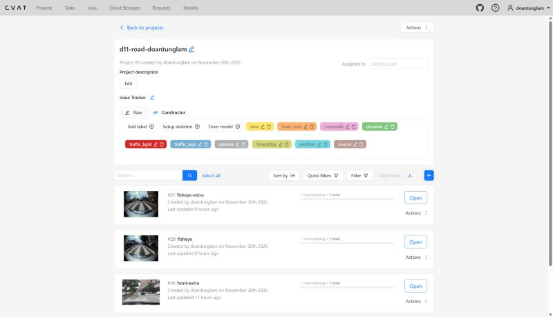
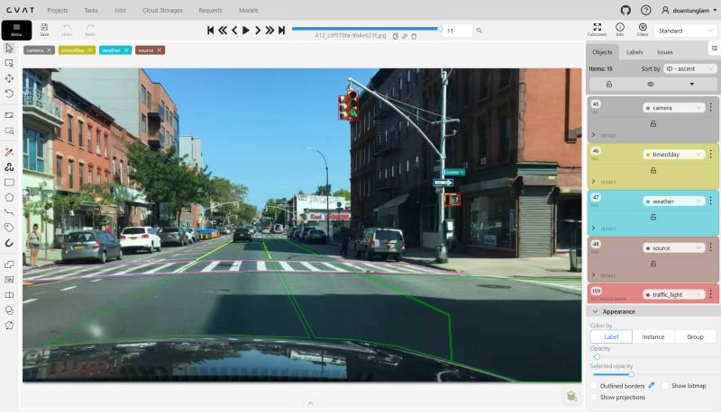
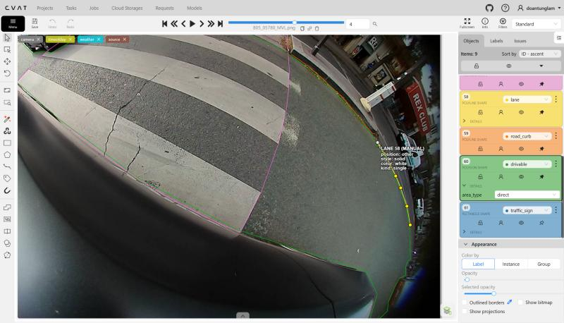
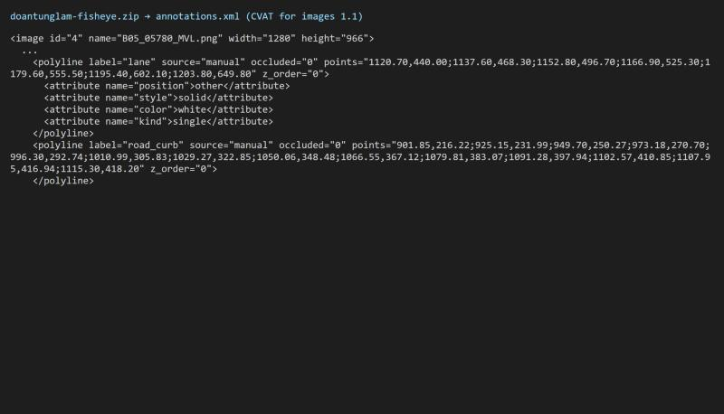

# Báo cáo cá nhân — Ngày 11
Họ tên: Doãn Tùng Lâm    
Mã học viên: 2A202603227  
Phiên bản CVAT (Help → About): 2.81.0  
Guideline: Road v1.0    Lần nộp (`revision` trong manifest): 1  
Thời điểm export (ngày giờ trên CVAT): 2026-11-22 07:10 (UTC)   
Số lần nộp lại sau Rework: 0  

## 1. Kiểm project

| Mục | Đúng như guideline Road v1.0? | Ghi chú |
| --- | --- | --- |
| 6 label, đúng kiểu | Đúng | lane, road_curb (polyline); crosswalk, drivable (polygon); traffic_light, traffic_sign (rectangle) |
| Thuộc tính và giá trị | Đúng | lane: position L1/R1/L2/R2/other, style solid/dashed, color white/yellow/other, kind single/double. drivable: area_type direct/alternative. traffic_light: color red/yellow/green/off/unknown, type vehicle/pedestrian/beacon, facing front/side/back, edge_zone. traffic_sign: group prohibitory/mandatory/warning/information/supplementary/other, facing, edge_zone |
| 4 tag ảnh | Đúng | camera (5 giá trị), timeofday day/dusk/night, weather clear/overcast/rain/fog/other, source real/simulated; mỗi tag có thuộc tính `value` |
| Cách kết thúc polyline trên bản CVAT này | Phím **N** | Chọn công cụ Polyline, click lần lượt các điểm trên tâm vệt sơn từ phía gần xe (đáy ảnh) ra xa, rồi bấm **N** để kết thúc đường |
| Cách đặt tag ảnh trên bản CVAT này | Công cụ **Tag** ở thanh bên trái | Đặt camera trước, rồi timeofday, weather, source. Mở **Details** của từng tag trong bảng Objects để kiểm giá trị (CVAT tự điền giá trị đầu tiên của danh sách) |

## 2. Số lượng đã gán
Đếm từ file export (số shape theo label; tag ảnh không tính).

| Task | Ảnh | lane | road_curb | crosswalk | drivable | traffic_light | traffic_sign |
| --- | ---: | ---: | ---: | ---: | ---: | ---: | ---: |
| front | 12 | 38 | 8 | 7 | 26 | 17 | 25 |
| front-extra (đã làm 4 / 4) | 4 | 13 | 1 | 4 | 8 | 11 | 12 |
| fisheye | 8 | 10 | 9 | 10 | 10 | 7 | 2 |
| fisheye-extra (đã làm 4 / 4) | 4 | 7 | 4 | 5 | 4 | 1 | 0 |

## 3. Bảng ca khó

| Ảnh | Nhãn | Phân vân giữa | Đã chọn | Lý do |
| --- | --- | --- | --- | --- |
| A03 | lane | Vạch vàng thứ hai cách L1 khoảng 40–46 px bên trái có phải lane không | Không gán | Gần xe nó chuyển thành đường viền dải phân cách sơn ở y≈570, không phải vạch làn |
| A03 | traffic_light | Gán hai đèn xanh xa hay bỏ | Không gán | Vỏ đèn bị nhòe chuyển động, không xác định được hộp |
| A05 | lane | Vẽ L1/R1 từ vệt mờ hay không vẽ | Không vẽ | Không thấy vạch sơn, chỉ có lề và hàng xe đỗ; lint báo QC1-02, hỏi coach |
| A05 | drivable | Có gồm dải đỗ xe không | Không gồm | Guideline loại dải đỗ khỏi direct; ranh giới đi qua điểm tiếp đất bên đường của các xe đỗ |
| A06 | lane | Không có R1 | Không vẽ R1 | Bên phải là hàng cột đường sắt trên cao, không có sơn; lint báo QC1-02, hỏi coach |
| A06 | traffic_light | Đèn người đi bộ WALK là green hay unknown | green | Hình người đi bộ sáng trắng-xanh là tín hiệu cho phép |
| A07 | lane | Chọn mép sơn hay chân dải bê tông cho L1 | Mép sơn | Lần fit đầu bám chân rào chắn lệch 17 px; vẽ lại trên dải sơn rộng khoảng 10 px |
| A07 | weather | rain hay overcast | rain | Đường ướt và có giọt nước trên kính chắn gió |
| A08 | lane | L1 không rõ | Không vẽ L1 | Chỉ còn vết sơn cũ rất mờ; lint báo QC1-02, hỏi coach |
| A08 | drivable | Ranh trái của direct | Ước lượng bằng R1 trừ bề rộng làn đo giữa R1 và R2 | Vạch trái không thấy; giả định, ghi nhận là ca khó |
| A09 | lane | Vạch trắng đôi bên trái có phải lane không | Không gán | Nó uốn vào mũi dải phân cách, không hội tụ về điểm biến mất nên không rõ position |
| A09 | traffic_sign | group của hai biển chữ nhật trắng bị chói | other | Chữ không đọc được nên không xếp vào nhóm nào chắc chắn |
| A10 | traffic_sign | Cụm biển trên cột trái là một hay nhiều biển | Tách 3 tấm theo đường biên màu, group prohibitory | Ba tấm riêng (NO PARKING, NO STANDING, ký hiệu P) đọc được là biển cấm |
| A12 | lane | Vạch nào là L1, vạch nào là R1 | Vạch liền = L1, vạch đứt = R1 | Kiểm hàng đáy ảnh: vạch liền kéo dài đến x=-123, vạch đứt đến x=703 tại y=720, tâm xe 640 nằm giữa. Lần đầu tôi gán ngược và đã sửa |
| A13 | lane | R2 liền hay đứt | Đứt | Hai vệt xa và gần cùng nằm trên một đường qua điểm biến mất, có khoảng trống giữa |
| A14 | lane | Vạch vàng đôi: một đường giữa hay hai đường | Hai polyline, đều L1 solid yellow kind double | Theo yêu cầu bài: vẽ cả hai nét, đánh `kind=double`. Lint sẽ báo QC1-05 |
| A14 | traffic_light | Đèn đỏ ở rìa phải là vehicle hay pedestrian | pedestrian | Hình bàn tay đỏ, đèn dành cho người đi bộ |
| A15 | traffic_sign | Hai tab cam trên biển giới hạn tốc độ | supplementary | Tab nằm tách phía trên mỗi biển, có thể là biển phụ hoặc một phần biển chính |
| A16 | lane | Vạch vàng sát vỉa trái là lane hay sơn vỉa | L2 solid yellow | Có sơn thật; guideline chỉ dùng road_curb khi không có sơn |
| B01, B02 | lane | Không có vạch dọc trước xe | Không vẽ L1/R1 | Xe đứng trên vạch ngựa vằn; lint báo QC1-02, hỏi coach |
| B02 | traffic_light | Hai đầu đèn lớn nhìn từ phía sau | facing back, color unknown | Thấy mặt sau, không có đèn sáng |
| B03, B04 | lane | Trái/phải ở camera sau: theo ảnh hay theo xe | Theo tọa độ ảnh | Bộ dữ liệu tổng hợp của repo đặt L1 ở bên trái ảnh cho cả FV và RV; nếu coach dùng trái/phải của xe thì R1/R2 ở B03 thành L1/L2 |
| B04 | drivable | Ranh trái của direct | Ước lượng theo vạch ngăn làn xe buýt | Không có sơn nhìn thấy; giả định |
| B05–B08, B10–B12 | drivable | Có vẽ drivable cho camera gương/bãi đỗ không | Có vẽ (đã bổ sung sau khi tự rà lại) | Góc nhìn ngang nên khó xác định "làn đang đi"; guideline không nói rõ. [KIỂM LẠI: sửa dòng này cho đúng với những gì bạn đã vẽ] |
| B05–B08 | lane | position cho camera hai bên | other | Luật fisheye: camera gương luôn là other |
| B08 | road_curb | Dùng vỉa fit tự động hay bỏ | Bỏ | Đường fit lệch 20–25 px, vỉa lại bị người đi xe đạp che |
| B11 | lane | Vạch vàng đôi sát lề: gộp một đường hay hai | Hai polyline kind double | Theo yêu cầu bài; có thêm vạch vàng đơn viền ô gạch chéo (không chắc có phải lane) |
| B12 | lane | Vệt trắng mảnh sát thân xe có phải vạch | Không gán | Quá mảnh, có thể là phản chiếu |

## 4. Phiếu QC 1 nhận được

Bạn kiểm lô của tôi: Trần Tuấn Anh - 2A202603230  
Quyết định nhận được: Rework  
Quyết định dự kiến theo tự kiểm: Release 

| Mã lỗi | Số lỗi | Đồng ý? | Đã sửa? |
| --- | ---: | --- | --- |
| QC1-02 đủ L1, R1 (nặng) | 4 (A05 ×2, A06, A09) | Không | Không sửa, Coach yêu cầu không thấy thì không cố đánh|
| QC1-04 tâm vạch, chiều, điểm dừng (chính) | 1 (A06) | Không | Lane nằm ngang nên đường vẽ polyline sẽ có hướng ngang, và position là other |
| QC1-05 vạch đứt, che (chính) | 7 (A04 ×2, A06, A08, A09, A11, A14) | Không | Đã hỏi Coach, vạch đôi thì vẫn vẽ 2 vạch (cả vạch liềng lẫn vạch đứt) và vẫn đánh kind là double |

## 5. Kiểm file export
Lint chạy với `--manifest doantunglam-manifest.json --name doantunglam --revision 1` (`contains_images` = false). Còn 12 cảnh báo: QC1-02 ở A05, A06, A09 (không thấy vạch); QC1-05 ở A04, A06, A08, A09, A11, A14 (vạch đôi vẽ hai polyline); QC1-04 ở A06 (vạch ngang bên trái xe, chiều gần-xa không rõ).

| File | Mở lại được? | Số shape ảnh 1 (job / file) | Số shape ảnh 2 (job / file) | Tag camera có trong XML? |
| --- | --- | --- | --- | --- |
| doantunglam-front.zip | Có (16 ảnh) | A01: 9 / 9 | A02: 7 / 7 | Có (`front`) |
| doantunglam-fisheye.zip | Có (12 ảnh) | B01: 5 / 5 | B02: 7 / 7 | Có (`fisheye_front`) |

## 6. Ảnh chụp màn hình
1. Tab Labels của project `d11-road-doantunglam` (6 label vẽ và 4 label tag):  

2. Ảnh camera trước A12 đã gán đủ (4 tag, làn, vùng lái, đèn, biển):  

3. Ảnh fisheye B05 (camera gương trái) đã gán, phóng to đoạn polyline cong

4. Một đoạn XML trong `doantunglam-fisheye.zip` có `<polyline label="lane">` (ảnh B05):  

## 7. Tự đánh giá
> Bản nháp dựa trên những gì thực sự xảy ra khi gán và khi chạy lint. Bạn đọc lại và sửa lại bằng lời của mình nếu có chỗ không đúng.

**Lỗi tôi mắc nhiều nhất hôm nay (theo mã QC1-xx), và cách tránh ở Ngày 20:**
- **Nghiêm trọng nhất là QC1-03** (position) và **QC1-02** (đủ L1, R1), vì cả hai là lỗi nặng:
  - B07 và B08: lane của camera gương trái/phải phải để `position = other`, ban đầu tôi để L/R. Lint báo QC1-03, đã sửa.
- **Cách tránh ở Ngày 20:**
  - (1) luôn làm phép kiểm "hàng đáy ảnh" cho mọi cặp L1/R1; \
  - (2) đo tâm vạch từ pixel và đối chiếu bằng overlay, không vẽ bằng mắt;
  - (3) chạy lint sau mỗi đợt sửa, không đợi tới cuối;
  - (4) với ảnh nghi ngờ, ghi vào bảng ca khó và hỏi coach sớm thay vì tự đoán.

**Nhãn của tôi đi vào model ở đâu, và một lỗi đã sửa làm model học sai thế nào:**
Nhãn làn của tôi là đích học cho model nhận dạng làn (ví dụ model row-anchor: với mỗi hàng ảnh model học tọa độ x của L1 và R1). Position là thứ model dùng để biết "đâu là biên trái và biên phải của làn xe đang đi", từ đó hệ thống giữ làn tính độ lệch của xe so với tâm làn.

Lỗi A12 (L1 và R1 bị gán ngược) minh họa rõ nhất. Nếu giữ nguyên nhãn sai, model sẽ học rằng ở cảnh giao lộ này, vạch bên phải xe là biên trái và ngược lại. Khi dùng trong giữ làn, độ lệch tính ra sẽ có dấu sai, tức là hệ thống đánh lái về phía vạch kia thay vì vào giữa làn. Đây là lý do QC1-03 là lỗi nặng: một nhãn sai ý nghĩa an toàn làm hỏng cả ảnh, và nếu nhiều ảnh sai cùng kiểu thì model học ngược một quy luật thật của đường.

## 8. (Tùy chọn, buffer) Từ polyline đến đích row-anchor
| y | 720 | 680 | 640 | 600 | 560 |
| --- | ---: | ---: | ---: | ---: | ---: |
| x của chúng tôi |  |  |  |  |  |
| x của bạn kia |  |  |  |  |  |

Trả lời 3 câu:

1. Năm số x đó chính là đích mà một model row-anchor học cho vạch này. Nếu bạn dừng polyline sớm 40 px, hàng nào đổi thành "không có làn"?
2. So với bạn được kiểm (cùng ảnh): ở hàng 720 và hàng 560, hai bạn lệch nhau bao nhiêu pixel? Lệch ở hàng nào ảnh hưởng LKA nhiều hơn (slide 25)?
3. Nếu polyline vẽ từ xa về gần (ngược quy tắc 2), cách tính trên có đổi không? Script nào sẽ gặp khó?
